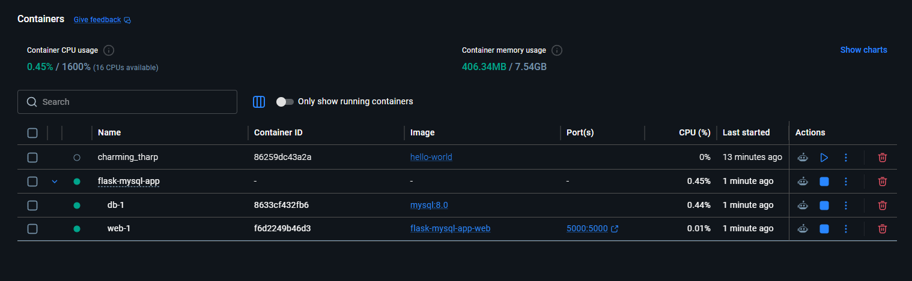
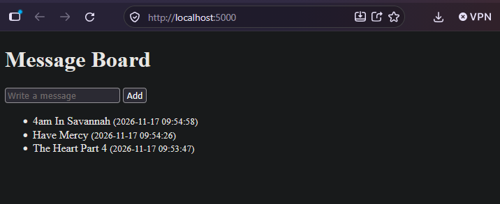

# Two-Tier Web App (Flask + MySQL) with Docker Compose

A Flask message board backed by MySQL, containerized with Docker and run with Docker Compose. This is Phase 1 of a CI/CD project: a Jenkins pipeline that builds, tests, and deploys this app comes next.

## Architecture

- **web:** Flask app served by gunicorn, built from the Dockerfile in this repo
- **db:** MySQL 8.0 with a named volume (`db_data`) so messages survive restarts
- Compose waits for the database health check to pass before starting the web container



## Run

```
docker compose up --build
```

Open http://localhost:5000, add a message, and it is saved in MySQL.

Optional: set `DB_PASSWORD` and `DB_ROOT_PASSWORD` in a `.env` file (ignored by git) to override the development defaults.

## Stop

```
docker compose down        # keeps the data
docker compose down -v     # also deletes the database volume
```

## Result



## Issues hit and fixes

- **`wsl` not recognized on Windows 10 Home:** the WSL and Virtual Machine Platform features were not enabled. Enabled both with DISM, restarted, and ran `wsl --update`.
- **`docker` not recognized right after installing Docker Desktop:** the open terminal did not have the new PATH. Opened a fresh terminal.
- **Files unzipped one folder too deep:** `docker compose` must run in the folder that contains `docker-compose.yml`.
- **Git repo found at my user folder:** a stray repository existed at the home directory, so I ran `git init` inside the project folder to get a clean repo.

## Next

Phase 2: Jenkins pipeline on EC2 that builds the image, runs tests, and pushes it to a registry.