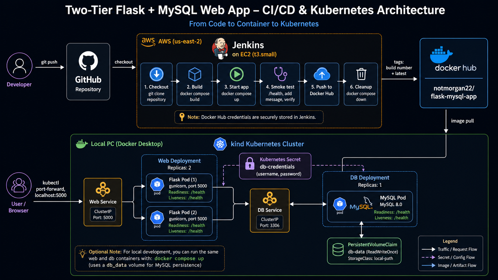
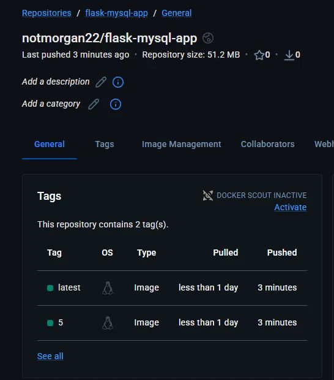
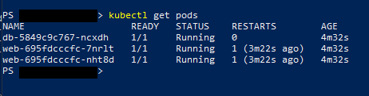
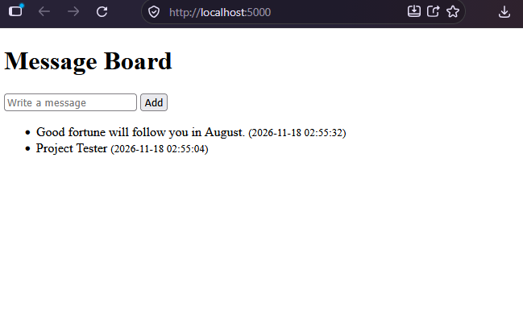

# Two-Tier Web App (Flask + MySQL) with Docker Compose and Jenkins CI/CD

A Flask message board backed by MySQL, containerized with Docker and run with Docker Compose. A Jenkins pipeline on EC2 builds the app, smoke tests it, and pushes the image to Docker Hub on every run.

## Architecture



- **web:** Flask app served by gunicorn, built from the Dockerfile in this repo
- **db:** MySQL 8.0 with a named volume (`db_data`) so messages survive restarts
- Compose waits for the database health check to pass before starting the web container
- **Jenkins (on EC2):** runs the pipeline defined in the `Jenkinsfile`
- **Docker Hub:** stores the built images


## Run locally

```
docker compose up --build
```

Open http://localhost:5000, add a message, and it is saved in MySQL.

Optional: set `DB_PASSWORD` and `DB_ROOT_PASSWORD` in a `.env` file (ignored by git) to override the development defaults.

## Stop

```
docker compose down        # keeps the data
docker compose down -v     # also deletes the database volume
```

## Result


## CI/CD pipeline (Jenkins)

The `Jenkinsfile` runs these stages:

1. **Checkout:** pulls the repo from GitHub
2. **Build:** `docker compose build`
3. **Start app:** `docker compose up -d`
4. **Smoke test:** waits for `/health`, posts a message to `/add`, and confirms it appears on the home page
5. **Push to Docker Hub:** builds the image and pushes it tagged with the build number and `latest` (only runs if the smoke test passed)
6. **Cleanup (always):** `docker compose down -v` and `docker logout`

The Docker Hub credentials are stored in Jenkins (credential ID `dockerhub`) and referenced from the Jenkinsfile by ID, so no secrets live in the repo.

### Pipeline result

Image pushed to Docker Hub with the build number and `latest` tags:



## Kubernetes deployment (kind)

The image pushed by Jenkins (`notmorgan22/flask-mysql-app`) is deployed to a local Kubernetes cluster created with kind.

- `k8s/mysql.yaml`: MySQL Deployment, a PersistentVolumeClaim so data survives pod restarts, and a Service named `db`
- `k8s/web.yaml`: Flask Deployment with 2 replicas, readiness and liveness probes on `/health`, and a Service named `web`
- Database passwords live in a Kubernetes Secret created with `kubectl`, never in the repo

```
kind create cluster --name flask-cluster
kubectl create secret generic db-credentials --from-literal=password=<choose> --from-literal=root-password=<choose>
kubectl apply -f k8s/
kubectl get pods
kubectl port-forward svc/web 5000:5000
```

Open http://localhost:5000.





## Issues hit and fixes

- **`wsl` not recognized on Windows 10 Home:** the WSL and Virtual Machine Platform features were not enabled. Enabled both with DISM, restarted, and ran `wsl --update`.
- **`docker` not recognized right after installing Docker Desktop:** the open terminal did not have the new PATH. Opened a fresh terminal.
- **Files unzipped one folder too deep:** `docker compose` must run in the folder that contains `docker-compose.yml`.
- **Git repo found at my user folder:** a stray repository existed at the home directory, so I ran `git init` inside the project folder to get a clean repo.
- **`docker compose build` failed on EC2:** the buildx plugin was not executable. Fixed with `chmod +x` on the `docker-buildx` CLI plugin.
- **Smoke test failed with `curl -X POST ... -L`:** forcing POST made curl repeat POST on the redirect. Removed `-X POST` so `-d` sends the POST and the redirect is followed as a GET.
- **`git push` from EC2 rejected my password:** GitHub requires a personal access token for HTTPS pushes. Edited the file on GitHub instead and synced the server with `git reset --hard origin/main`.
- **GitHub push protection flagged a secret:** kept the Docker Hub token in Jenkins credentials only, never in the repo.
- **Web pods restarted once at startup:** the Flask app retries the database connection, but the pods started before MySQL was ready, so Kubernetes restarted them once. They then stayed stable, and the readiness probes keep traffic away until `/health` passes.
- **Database credentials:** created the Kubernetes Secret from the command line so no password is committed to the repo.

## Next

- Add automated tests (e.g. `pytest`) and a lint stage
- Auto-trigger builds on push with a GitHub webhook
